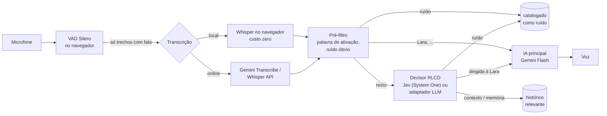

# Lara

**Assistente pessoal por voz que fica com você o tempo todo.** Escuta continuamente, entende o que está acontecendo ao seu redor e só fala quando você a chama — ou quando realmente precisa.

PHP + MySQL no servidor, PWA no navegador (desktop ou celular, inclusive com fone de ouvido).

## Como funciona

Ficar ouvindo o dia inteiro só é viável se quase nada custar dinheiro. Por isso cada etapa filtra o máximo possível antes da seguinte, que é mais cara:



1. **Detecção de voz (VAD)** — o [Silero VAD](https://github.com/ricky0123/vad) roda no navegador e recorta só os trechos com fala. Silêncio nunca sai do aparelho.
2. **Transcrição** — por padrão **local**: [Whisper](https://huggingface.co/onnx-community) via [transformers.js](https://huggingface.co/docs/transformers.js) (WebGPU quando disponível, senão WebAssembly). Custo de API zero. Um switch troca para **online** (Gemini 3.5 Transcribe, Whisper etc., via OpenRouter, Gemini, Groq ou OpenAI) quando você quer mais qualidade.
3. **Pré-filtro** (PHP, grátis, instantâneo) — descarta alucinações típicas do Whisper ("Legendas pela comunidade Amara.org", "[Música]"), hesitações soltas e detecta a palavra de ativação. Se você disse "Lara", vai direto para a resposta.
4. **Decisor RLCD** — para o resto, um modelo de decisão calibrada responde perguntas tipadas sobre a fala:
   - `addressed` (noul): a fala é dirigida à Lara?
   - `needs_reply` (noul): uma assistente deveria falar agora?
   - `relevance` (choice): `noise` · `context` · `memory`
   - `importance` (score): irrelevante → importante

   Há dois motores. O **Jev** da TypeSafe (RLCD — *Reinforcement Learning for Calibrated Decisions*), um modelo "System One" que devolve probabilidades em vez de texto, em ~70–500 ms segundo o fabricante, cobrando só os tokens de entrada. Ele é chamado pelo endpoint `POST /systemone`, que tem o mesmo formato [direto na TypeSafe](https://docs.typesafe.ai/api) e [pelo OpenRouter](https://openrouter.ai/docs/api/api-reference/systemone/submit-a-system-one-request) (`~typesafe/jev-latest`, `typesafe/jev-1.13` e outros modelos de decisão). A alternativa é o **adaptador Jev-compatível**, que faz as *mesmas* perguntas a qualquer LLM barato (Gemini Flash-Lite, Llama no Groq, um modelo local no Ollama…) e devolve as respostas no mesmo formato — o restante do sistema não percebe a troca. O assistente de configuração escolhe o Jev sempre que há chave do OpenRouter ou da TypeSafe.
5. **Política** — responde se `addressed ≥ limiar`. Logo depois de a Lara falar (janela de continuação), `needs_reply` também conta, para réplicas sem o nome dela ("e que horas mesmo?"). Fora disso ela não interrompe.
6. **IA principal** — recebe **somente** falas catalogadas como dirigidas a ela ou relevantes, mais memórias antigas recuperadas por busca textual no MySQL. Ruído, conversas de terceiros sem relação e o modo de transcrição nunca chegam até ela.
7. **Voz** — a do navegador (grátis) ou TTS do OpenRouter, Gemini, OpenAI ou ElevenLabs.

### Tudo é catalogado, mesmo quando ela não responde

Toda voz captada vira uma linha em `messages` com `relevance`:

| relevance   | significado                                                         | vai para a IA principal? |
| ----------- | ------------------------------------------------------------------- | ------------------------ |
| `addressed` | falaram com a Lara                                                  | sim                      |
| `relevant`  | conversa ao redor que pode servir de contexto ou memória            | sim, marcada "(ao redor)" |
| `noise`     | TV, música, vozes distantes, alucinação do Whisper                  | não                      |
| `pending`   | decisor estava fora do ar — reprocesse com `php bin/lara.php redecide` | não                      |
| `failed`    | transcrição falhou; o áudio fica guardado                           | não                      |

Assim, uma conversa de manhã ("a reunião com a Construtora Alfa ficou para quinta às 15h") pode ser usada à tarde ("Lara, quando é a reunião com a Construtora?").

### Transcrição local × online sem quebrar nada

O switch muda apenas **de onde vem o texto**. A partir do texto, o fluxo é idêntico. A origem fica só em `messages.transcript_source` (`local`/`online`) e `transcript_engine`, colunas de controle interno que nunca são enviadas a nenhuma IA nem à interface. Trocar no meio da conversa não perde nada: cada trecho fixa o modo no momento em que foi capturado.

## Requisitos

- PHP 8.1+ com `curl`, `pdo_mysql`, `mbstring` (e `intl`, recomendado para normalizar acentos)
- MySQL 8+ (usa `JSON` e `FULLTEXT`)
- Apache 2.4 com `mod_rewrite` e `mod_headers` (as regras de proteção e as URLs sem `.php` estão no `.htaccess`)
- **HTTPS** em produção — o navegador só libera o microfone em contexto seguro (exceto `localhost`)
- Navegador: Chrome/Edge (desktop ou Android) recomendados; WebGPU acelera bastante o Whisper local
- Uma chave de IA. **Só o OpenRouter já basta** (conversa, triagem, transcrição online e voz); Gemini, Groq, OpenAI, ElevenLabs, TypeSafe Jev e Ollama são alternativas ou complementos

## Instalação

1. Envie os arquivos para o servidor (ou `git clone https://github.com/arismarioneves/lara.git`). Funciona na raiz do domínio ou em subpasta.
2. Abra o endereço no navegador. Sem `config.php`, a Lara abre o **assistente de configuração**:

| Passo         | O que acontece                                                                                          |
| ------------- | ------------------------------------------------------------------------------------------------------- |
| Requisitos    | confere PHP, extensões, permissões de escrita, HTTPS e se o `.htaccess` está protegendo `storage/`       |
| Banco         | servidor, porta, nome, usuário e senha; **Testar conexão**; cria o banco se não existir                  |
| Acesso        | sua senha, seu nome, nome da assistente (vira a palavra de ativação) e fuso horário                      |
| Provedores    | cole as chaves; **Testar** valida cada uma e lista os modelos disponíveis; mostra quais papéis ficam cobertos |
| Recursos      | escolhe quem faz cada trabalho: Conversa, Triagem, Transcrição online e Voz — já vem com sugestões        |
| Concluir      | grava o `config.php`, cria as tabelas, salva o perfil e entra no app                                     |

Se o servidor não permitir criar arquivos na pasta, o último passo mostra o `config.php` pronto para baixar e enviar manualmente.

> **Faça a configuração logo após publicar.** Enquanto não existe `config.php`, qualquer pessoa que abrir o endereço vê o assistente. Depois de instalado, ele não pode ser executado de novo (só a reconfiguração da IA, com login e senha).

No celular, use "Adicionar à tela inicial" para instalar como app.

## Configuração

Há três níveis, do mais usado ao mais raro:

**Configurações** (engrenagem no app) — interação do dia a dia, salva no MySQL (`settings`):

| Grupo                | O que dá para trocar                                                                       |
| -------------------- | ------------------------------------------------------------------------------------------ |
| Assistente           | nome, seu nome, palavras de ativação, idioma, personalidade (prompt)                       |
| Voz                  | voz (das oferecidas pelo modelo configurado), estilo de fala, botão de prévia              |
| Escuta e transcrição | transcrição local/online, tamanho do Whisper local, sensibilidade do VAD, interromper falando por cima, guardar áudio |
| Quando responder     | limiar para responder, janela de continuação                                               |
| Memória              | quantas falas recentes e quantas memórias antigas vão para a IA                            |
| Este aparelho        | microfone (ex.: fone Bluetooth), modo caminhada, manter tela ligada (ficam no navegador)   |

**Reconfigurar IA** (botão no fim das Configurações; pede a senha de novo) — o mesmo assistente da instalação, só com *Provedores* e *Recursos*: troca chaves e modelos e regrava o `config.php`. Chave em branco mantém a atual; as chaves salvas nunca voltam para o navegador. Banco de dados e senha não aparecem aqui.

**`config.php`** (fora do git) — gerado pelo assistente, legível e editável à mão para ajustes avançados: banco, hash da senha, `debug`, `session_days`, `storage_path`, URLs dos provedores. Para trocar a senha: `php bin/lara.php password "nova-senha"` e cole o hash em `app.password_hash`. "Reconfigurar IA" regrava o arquivo preservando os valores, mas não os comentários.

### Os papéis de IA

| Papel                  | O que faz                                                         | Provedores                                     |
| ---------------------- | ----------------------------------------------------------------- | ---------------------------------------------- |
| **Conversa**           | pensa e responde; só é chamada quando a Lara decide falar         | OpenRouter, Gemini, OpenAI, Groq, Ollama       |
| **Triagem** (RLCD)     | avalia cada fala: é comigo? responder? memória, contexto ou ruído? | Jev pelo OpenRouter ou pela TypeSafe; ou adaptador sobre OpenRouter, Gemini, OpenAI, Groq, Ollama |
| **Transcrição online** | opcional; a padrão é o Whisper local, grátis                      | OpenRouter, Gemini, Groq, OpenAI               |
| **Voz**                | como a Lara fala                                                  | navegador (grátis), OpenRouter, Gemini, OpenAI, ElevenLabs |

Sugestões com OpenRouter: `google/gemini-3.8-flash` (conversa, raciocínio baixo), `~typesafe/jev-latest` (triagem), `google/gemini-3.5-transcribe` e `google/gemini-3.8-flash-lite-tts`.

## Uso em movimento, com fone de ouvido

O que o PWA consegue hoje:

- **Permissão do microfone**: o pedido aparece no primeiro toque na esfera. Se o navegador bloquear (ou não houver microfone, ou outro app estiver usando), a Lara mostra um cartão com o passo a passo para liberar neste aparelho — Android, iPhone, app instalado ou aba — e um botão para tentar de novo. Ao liberar nas configurações do sistema, o cartão some sozinho.
- **Microfone do fone**: escolha o fone Bluetooth em *Configurações → Este aparelho*.
- **Interromper falando**: com fone não há eco, então ative *Interromper a Lara falando por cima* — sua voz corta a resposta dela. Sem essa opção, o que é captado enquanto ela fala é descartado como eco.
- **Modo caminhada**: toca um áudio silencioso em loop para o sistema tratar a página como "tocando mídia". No Android/Chrome isso costuma manter a captura com a tela bloqueada e liga os botões do fone/relógio (play/pause liga e pausa a Lara pela Media Session). O comportamento em segundo plano varia por fabricante e economia de bateria — teste no seu aparelho.
- **Manter tela ligada**: Screen Wake Lock enquanto escuta.

Limites conhecidos:

- **iOS/Safari** suspende o microfone de PWAs em segundo plano; lá, use com a tela ligada.
- **Bluetooth em modo chamada (HFP)**: quando o microfone do fone está ativo, o áudio cai para banda estreita; a transcrição continua, mas a qualidade de voz da Lara diminui.
- Em aba em segundo plano **sem** o modo caminhada, o Chrome pode adiar a reprodução da resposta; a Lara desiste em 10 s em vez de travar.
- Escuta realmente contínua com tela desligada por horas, em qualquer aparelho, exige um app nativo (ex.: TWA/Capacitor com serviço em primeiro plano). A arquitetura já permite isso: o app nativo só precisaria enviar os trechos para `api/ingest`.

## Dados e privacidade

- Textos e catalogação: MySQL (`messages`, `settings`).
- Áudios (falas captadas e vozes geradas), sessões e logs: `storage/`, bloqueada por `.htaccess` (`Require all denied`). O acesso é só via `api/audio` e `api/tts`, com sessão. Em produção, prefira apontar `storage_path` para fora da raiz web — nesse caso crie lá, com permissão de escrita, as mesmas pastas que vêm no repositório: `sessions/`, `logs/`, `audio/heard/` e `audio/spoken/`. A aplicação não cria pastas.
- Login com senha única (hash em `config.php`), cookie `HttpOnly` + `SameSite=Strict`, token CSRF em toda escrita, CSP restritiva.
- `src/`, `database/`, `bin/`, `tests/`, `config.php` e arquivos ocultos também são bloqueados pelo `.htaccess`.
- Lembre que gravar conversas de terceiros pode exigir consentimento conforme a legislação local.

## Linha de comando

```bash
php bin/lara.php migrate     # cria/atualiza as tabelas (idempotente)
php bin/lara.php password X  # gera o hash para trocar a senha no config.php
php bin/lara.php redecide    # cataloga falas que ficaram pendentes (decisor fora do ar)
php bin/lara.php stats       # contagem por papel, catalogação e origem da transcrição
php tests/run.php            # testes das regras de decisão, do adaptador e da configuração
```

## Estrutura

```
index.php               PWA (login + app); sem config.php redireciona para o assistente
setup.php               assistente: instalação completa e "Reconfigurar IA"
api/                    endpoints JSON: session, ingest, history, settings, tts, audio, setup
src/
  Assistant/            Pipeline, Prefilter, Decision (perguntas + política), Context
  Ai/                   GeminiChat, OpenAiChat, Transcriber, Speech, SystemOneDecider (Jev), LlmDecider
  Setup/                Catalog (provedores e papéis), Probe (testar chave), AiConfig, Installer, ConfigFile
  Config, Db, Settings, Auth, Api, Http, Storage, Log
assets/js/              app, listener (VAD), whisper.worker (Whisper local), voice, companion, settings, setup
database/schema.sql     esquema MySQL
storage/                sessions/, logs/, audio/heard/, audio/spoken/ (privado; pastas versionadas)
bin/lara.php            CLI
```

## Licença

[MIT](LICENSE) — Arismário Neves
