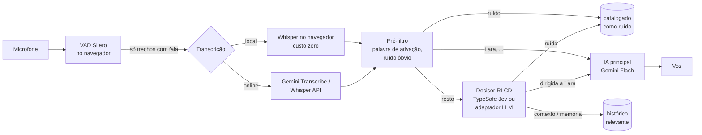

# Lara

**Assistente pessoal por voz que fica com você o tempo todo.** Escuta continuamente, entende o que está acontecendo ao seu redor e só fala quando você a chama — ou quando realmente precisa.

PHP + MySQL no servidor, PWA no navegador (desktop ou celular, inclusive com fone de ouvido).

## Como funciona

Ficar ouvindo o dia inteiro só é viável se quase nada custar dinheiro. Por isso cada etapa filtra o máximo possível antes da seguinte, que é mais cara:



1. **Detecção de voz (VAD)** — o [Silero VAD](https://github.com/ricky0123/vad) roda no navegador e recorta só os trechos com fala. Silêncio nunca sai do aparelho.
2. **Transcrição** — por padrão **local**: [Whisper](https://huggingface.co/onnx-community) via [transformers.js](https://huggingface.co/docs/transformers.js) (WebGPU quando disponível, senão WebAssembly). Custo de API zero. Um switch troca para **online** (Gemini 3.5 Transcribe, Whisper do Groq/OpenAI) quando você quer mais qualidade.
3. **Pré-filtro** (PHP, grátis, instantâneo) — descarta alucinações típicas do Whisper ("Legendas pela comunidade Amara.org", "[Música]"), hesitações soltas e detecta a palavra de ativação. Se você disse "Lara", vai direto para a resposta.
4. **Decisor RLCD** — para o resto, um modelo de decisão calibrada responde perguntas tipadas sobre a fala:
   - `addressed` (noul): a fala é dirigida à Lara?
   - `needs_reply` (noul): uma assistente deveria falar agora?
   - `relevance` (choice): `noise` · `context` · `memory`
   - `importance` (score): irrelevante → importante

   O motor padrão é o [TypeSafe Jev](https://docs.typesafe.ai/) (RLCD — *Reinforcement Learning for Calibrated Decisions*): devolve probabilidades em vez de texto, em ~70–500 ms segundo o fabricante, cobrando só os tokens de entrada. A alternativa aberta é o **adaptador Jev-compatível**, que faz as *mesmas* perguntas a qualquer LLM barato (Gemini Flash-Lite, Llama no Groq, um modelo local no Ollama…) e devolve as respostas no mesmo formato — o restante do sistema não percebe a troca.
5. **Política** — responde se `addressed ≥ limiar`. Logo depois de a Lara falar (janela de continuação), `needs_reply` também conta, para réplicas sem o nome dela ("e que horas mesmo?"). Fora disso ela não interrompe.
6. **IA principal** — recebe **somente** falas catalogadas como dirigidas a ela ou relevantes, mais memórias antigas recuperadas por busca textual no MySQL. Ruído, conversas de terceiros sem relação e o modo de transcrição nunca chegam até ela.
7. **Voz** — a do navegador (grátis) ou Gemini TTS, OpenAI TTS, ElevenLabs.

### Tudo é catalogado, mesmo quando ela não responde

Toda voz captada vira uma linha em `messages` com `relevance`:

| relevance   | significado                                                         | vai para a IA principal? |
| ----------- | ------------------------------------------------------------------- | ------------------------ |
| `addressed` | falaram com a Lara                                                  | sim                      |
| `relevant`  | conversa ao redor que pode servir de contexto ou memória            | sim, marcada "(ao redor)" |
| `noise`     | TV, música, vozes distantes, alucinação do Whisper                  | não                      |
| `pending`   | decisor estava fora do ar — reprocesse com `php bin/lara.php redecide` | não                      |
| `failed`    | transcrição falhou; o áudio fica guardado                           | não                      |

Assim, uma conversa de manhã ("a reunião com a Construtora Alfa ficou para quinta às 15h") pode ser usada à tarde ("Lara, quando é a reunião com a Construtora?").

### Transcrição local × online sem quebrar nada

O switch muda apenas **de onde vem o texto**. A partir do texto, o fluxo é idêntico. A origem fica só em `messages.transcript_source` (`local`/`online`) e `transcript_engine`, colunas de controle interno que nunca são enviadas a nenhuma IA nem à interface. Trocar no meio da conversa não perde nada: cada trecho fixa o modo no momento em que foi capturado.

## Requisitos

- PHP 8.1+ com `curl`, `pdo_mysql`, `mbstring` (e `intl`, recomendado para normalizar acentos)
- MySQL 8+ (usa `JSON` e `FULLTEXT`)
- Apache 2.4 com `mod_rewrite` e `mod_headers` (as regras de proteção estão no `.htaccess`)
- **HTTPS** em produção — o navegador só libera o microfone em contexto seguro (exceto `localhost`)
- Navegador: Chrome/Edge (desktop ou Android) recomendados; WebGPU acelera bastante o Whisper local
- Pelo menos uma chave de IA para a resposta (Gemini recomendado) e, para o decisor, uma chave TypeSafe **ou** qualquer provedor do adaptador

## Instalação

```bash
git clone https://github.com/arismarioneves/lara.git
cd lara
cp config.example.php config.php
php bin/lara.php password "uma-senha-forte"   # cole o hash em app.password_hash
```

Edite `config.php`: banco de dados, hash da senha e as chaves dos provedores que for usar. Depois:

```bash
mysql -u root -e "CREATE DATABASE lara CHARACTER SET utf8mb4 COLLATE utf8mb4_unicode_ci"
php bin/lara.php migrate
```

Aponte o Apache para a pasta (funciona também em subpasta), abra no navegador, entre com a senha e toque na esfera. No celular, use "Adicionar à tela inicial" para instalar como app.

## Configuração

**`config.php`** (fora do git) guarda o que é segredo: banco, senha, chaves e URLs dos provedores. Só provedores com chave aparecem como opção na interface; as chaves nunca saem do servidor.

**Tela de configurações** (engrenagem) guarda o resto no MySQL, tabela `settings`:

| Grupo        | O que dá para trocar                                                                        |
| ------------ | ------------------------------------------------------------------------------------------- |
| Assistente   | nome, seu nome, palavras de ativação, idioma, personalidade (prompt)                         |
| IA principal | provedor (Gemini, OpenRouter, Groq, OpenAI, Ollama), modelo, nível de raciocínio             |
| Decisor      | Jev ou adaptador LLM, modelo, limiar para responder, janela de continuação                   |
| Transcrição  | local/online, tamanho do Whisper local, provedor e modelo online                             |
| Voz          | navegador, Gemini, OpenAI ou ElevenLabs; modelo, voz, estilo; botão de prévia                 |
| Captura      | sensibilidade do VAD, interromper falando por cima, guardar áudio                            |
| Memória      | quantas falas recentes e quantas memórias antigas vão para a IA                              |
| Este aparelho | microfone (ex.: fone Bluetooth), modo caminhada, manter tela ligada (ficam no navegador)   |

Padrões: resposta com `gemini-3.8-flash` (raciocínio baixo), decisor `jev-latest`, Whisper `base` local, voz do navegador.

## Uso em movimento, com fone de ouvido

O que o PWA consegue hoje:

- **Microfone do fone**: escolha o fone Bluetooth em *Configurações → Este aparelho*.
- **Interromper falando**: com fone não há eco, então ative *Interromper a Lara falando por cima* — sua voz corta a resposta dela. Sem essa opção, o que é captado enquanto ela fala é descartado como eco.
- **Modo caminhada**: toca um áudio silencioso em loop para o sistema tratar a página como "tocando mídia". No Android/Chrome isso costuma manter a captura com a tela bloqueada e liga os botões do fone/relógio (play/pause liga e pausa a Lara pela Media Session). O comportamento em segundo plano varia por fabricante e economia de bateria — teste no seu aparelho.
- **Manter tela ligada**: Screen Wake Lock enquanto escuta.

Limites conhecidos:

- **iOS/Safari** suspende o microfone de PWAs em segundo plano; lá, use com a tela ligada.
- **Bluetooth em modo chamada (HFP)**: quando o microfone do fone está ativo, o áudio cai para banda estreita; a transcrição continua, mas a qualidade de voz da Lara diminui.
- Em aba em segundo plano **sem** o modo caminhada, o Chrome pode adiar a reprodução da resposta; a Lara desiste em 10 s em vez de travar.
- Escuta realmente contínua com tela desligada por horas, em qualquer aparelho, exige um app nativo (ex.: TWA/Capacitor com serviço em primeiro plano). A arquitetura já permite isso: o app nativo só precisaria enviar os trechos para `api/ingest.php`.

## Dados e privacidade

- Textos e catalogação: MySQL (`messages`, `settings`).
- Áudios (falas captadas e vozes geradas), sessões e logs: `storage/`, bloqueada por `.htaccess` (`Require all denied`). O acesso é só via `api/audio.php` e `api/tts.php`, com sessão. Em produção, prefira apontar `storage_path` para fora da raiz web.
- Login com senha única (hash em `config.php`), cookie `HttpOnly` + `SameSite=Strict`, token CSRF em toda escrita, CSP restritiva.
- `src/`, `database/`, `bin/`, `tests/`, `config.php` e arquivos ocultos também são bloqueados pelo `.htaccess`.
- Lembre que gravar conversas de terceiros pode exigir consentimento conforme a legislação local.

## Linha de comando

```bash
php bin/lara.php migrate     # cria/atualiza as tabelas (idempotente)
php bin/lara.php password X  # gera o hash da senha
php bin/lara.php redecide    # cataloga falas que ficaram pendentes (decisor fora do ar)
php bin/lara.php stats       # contagem por papel, catalogação e origem da transcrição
php tests/run.php            # testes das regras de decisão e do adaptador
```

## Estrutura

```
index.php               PWA (login + app)
api/                    endpoints JSON: session, ingest, history, settings, tts, audio
src/
  Assistant/            Pipeline, Prefilter, Decision (perguntas + política), Context
  Ai/                   GeminiChat, OpenAiChat, Transcriber, Speech, JevDecider, LlmDecider
  Config, Db, Settings, Auth, Api, Http, Storage, Log
assets/js/              app, listener (VAD), whisper.worker (Whisper local), voice, companion, settings
database/schema.sql     esquema MySQL
storage/                áudios, sessões, logs (privado)
bin/lara.php            CLI
```

## Licença

[MIT](LICENSE) — Arismário Neves
